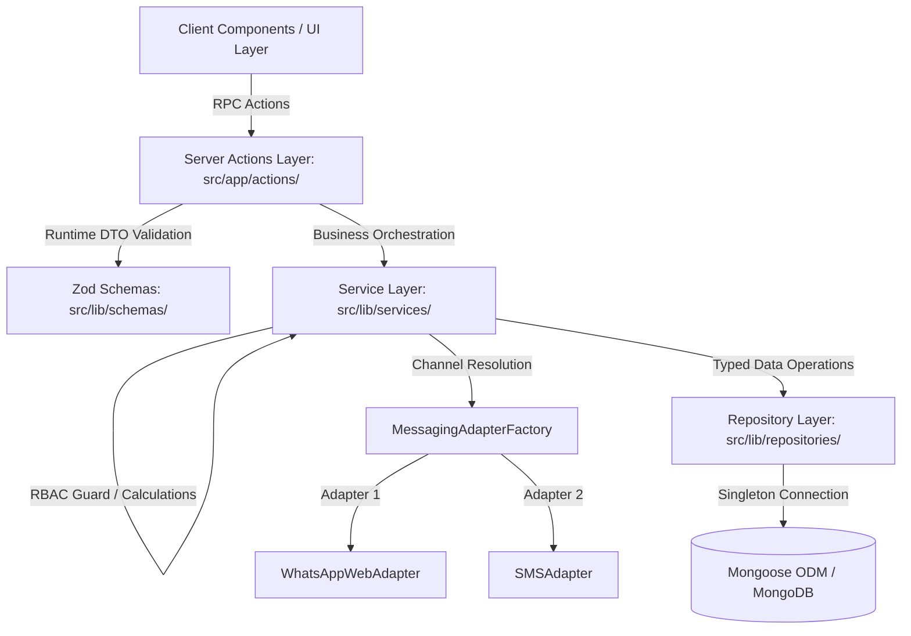

# Architecture & Design Patterns Specification

**Application:** WhatsApp Digital Invoicing & POS Application  
**Version:** 2.0.0 (Next.js 16.4.3 / React 19)  
**Status:** Approved & Implemented  

---

## 1. Architectural Layers & Separation of Concerns

The application adheres to clean layered architecture, enforcing strict boundaries between the transport, domain, data access, and third-party integration layers:



---

## 2. SOLID Principles Deep-Dive

### 2.1 Single Responsibility Principle (SRP)
* **Server Actions (`src/app/actions/`):** Act strictly as lightweight RPC controllers. They extract session authentication, call services, and trigger `revalidatePath()`. They contain zero raw MongoDB queries or discount calculations.
* **Services (`src/lib/services/`):** Contain all business rules: `InvoiceService` enforces owner-only bill edits, validates customer ownership, and generates 90-day aggregations. `MenuService` manages catalog rules and auto-provisioning of categories.
* **Repositories (`src/lib/repositories/`):** Dedicated exclusively to querying, pagination, and projection from MongoDB documents to lean DTOs.

### 2.2 Open / Closed Principle (OCP)
* **Messaging Subsystem:** `InvoiceService` relies on the `IMessagingAdapter` interface. Adding Twilio, AWS SNS, or Telegram support requires authoring a new adapter implementing `IMessagingAdapter` and registering it in `MessagingAdapterFactory`—the invoice logic is completely closed to modification.

### 2.3 Liskov Substitution Principle (LSP)
* Both `WhatsAppWebAdapter` and `SMSAdapter` satisfy the `IMessagingAdapter` contract:
  ```typescript
  export interface IMessagingAdapter {
      readonly channel: string;
      sendBill(payload: BillMessagePayload): Promise<ISendResult>;
  }
  ```
  Any consumer expecting `IMessagingAdapter` can receive either adapter without experiencing runtime divergence.

### 2.4 Interface Segregation Principle (ISP)
* Lean domain DTOs in `src/types/domain.ts` define only the attributes needed by each layer:
  * `InvoiceItemDTO` (Name, Price, Quantity) avoids leaking database internal fields.
  * `CustomerDTO` exposes only customer presentation attributes.
  * `BillMessagePayload` contains solely the fields required to build message strings.

### 2.5 Dependency Inversion Principle (DIP)
* High-level modules (Controllers and Services) depend on abstractions (`IRepository`, `IMessagingAdapter`) rather than concrete Mongoose models or external APIs directly.

---

## 3. Design Patterns Applied

### 3.1 Singleton Pattern
* **Database Connection Singleton (`src/lib/mongoose.ts`):**  
  Uses typed global cache `_mongooseCache` to reuse MongoDB connection pools across serverless invocations and Next.js hot module reloads, preventing connection exhaustion.
* **Service & Repository Singletons:**  
  `invoiceRepository`, `customerRepository`, `menuRepository`, `invoiceService`, `customerService`, and `menuService` are instantiated once and exported as singletons.

### 3.2 Adapter Pattern
* **Omnichannel Messaging:**  
  * `WhatsAppWebAdapter`: Translates the internal `BillMessagePayload` into a URL-encoded `wa.me` deep link.
  * `SMSAdapter`: Translates the payload into an RFC-compliant `sms:` deep link.
  * Callers deal exclusively with `IMessagingAdapter.sendBill()`.

### 3.3 Factory & Strategy Pattern
* **`MessagingAdapterFactory`:**  
  Maintains a registry of available messaging strategies:
  ```typescript
  const adapter = MessagingAdapterFactory.getAdapter('whatsapp'); // or 'sms'
  await adapter.sendBill(payload);
  ```
  Enables runtime strategy resolution and dynamic third-party adapter registration.

### 3.4 Repository Pattern
* Concrete implementations (`InvoiceRepository`, `CustomerRepository`, `MenuRepository`) encapsulate Mongoose queries, lean projections, and serialization into strongly typed DTOs.

### 3.5 Service Layer Pattern
* Encapsulates domain logic, multi-step transactions, and access control checks away from HTTP request/response handlers.

### 3.6 Audit Trail & Observer Pattern (ActivityLogService)
* **`ActivityLogService` (`src/lib/services/ActivityLogService.ts`):**
  * Acts as a non-blocking asynchronous event observer across all state-mutating actions (Invoices, Customers, Bookings, Menu, Categories, Coupons, Team, Settings).
  * Automatically stores snapshot details of the actor (`name`, `email`, `role: 'OWNER' | 'STAFF'`), tenant account ID (`effectiveUserId`), timestamp, entity type, and full context payload.
  * Ensures operations are cleanly segregated by account (`tenantId`) and indexed for real-time querying.

---

## 4. Production Database Configuration & Hardening

* **Enforced Production Database Name (`dbName`):**
  * Configured in `src/lib/mongoose.ts` as `opts.dbName = process.env.MONGODB_DB_NAME || 'primebake-prod'`.
  * **Critical Safeguard:** Prevents connections from silently falling back to the MongoDB Atlas default database (`test`) when using unadorned cluster URIs (`mongodb+srv://...mongodb.net/?...`).
* **Connection Pooling:**
  * `maxPoolSize: 10`, `serverSelectionTimeoutMS: 5000`, `socketTimeoutMS: 45000`, and `bufferCommands: false` to optimize connection lifecycle in serverless runtime environments.

