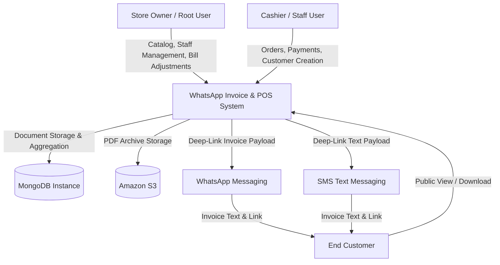
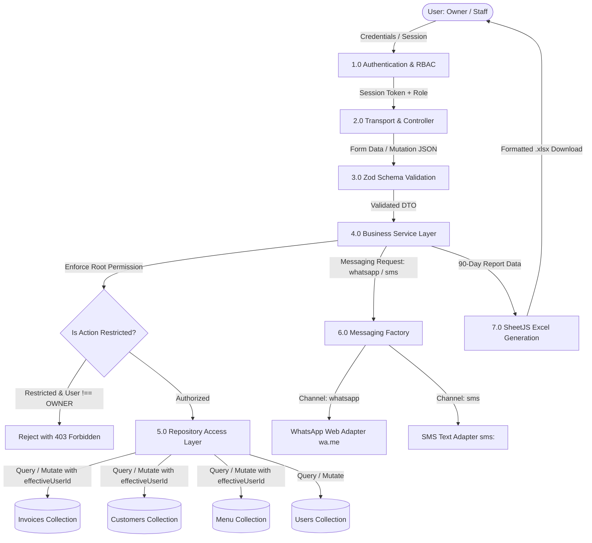
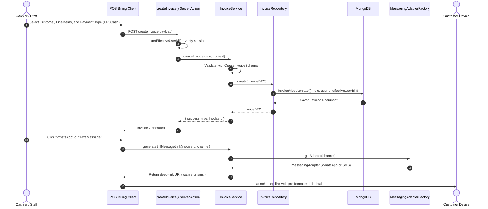
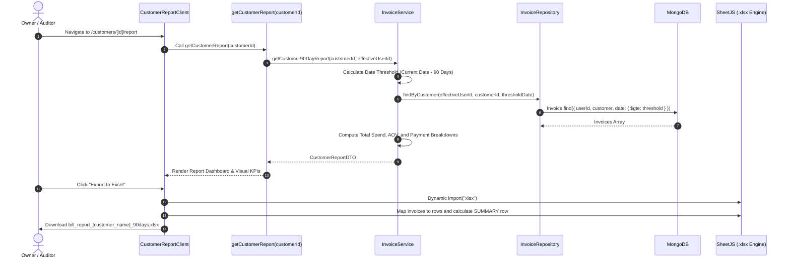
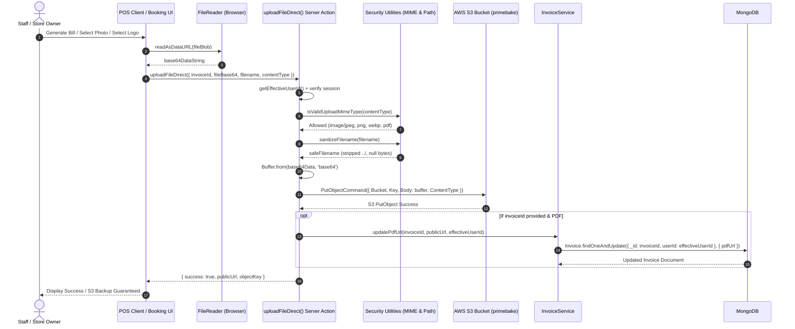

# Data Flow Diagrams (DFD)

**Application:** WhatsApp Digital Invoicing & POS Application  
**Version:** 2.1.0 (App v1.3.0 • Next.js 16.4.3 / React 19)  
**Status:** Approved & Implemented  

---

## 1. DFD Level 0: Context Diagram

The Level 0 Context Diagram depicts the primary external entities interacting with the WhatsApp Invoice & POS System boundary.

---

## 2. DFD Level 1: System Level Data Flow

The Level 1 diagram breaks down the internal architecture into functional sub-processes, showing data stores and data transformations.

---

## 3. DFD Level 2: Invoice Creation & Dispatch Sub-Process

Detailed flow showing the steps taken from client order assembly to persistent storage and omnichannel customer dispatch.

---

## 4. DFD Level 2: 90-Day Customer Report & Excel Export Sub-Process

Detailed flow demonstrating data aggregation and spreadsheet generation for a specific customer.

---

## 5. DFD Level 2: Direct Server-Side S3 Storage Sub-Process (`uploadFileDirect`)

Detailed sequence showing direct file streaming from browser through Next.js Server Action to AWS S3, bypassing browser CORS restrictions and automatically linking PDF records in MongoDB.

