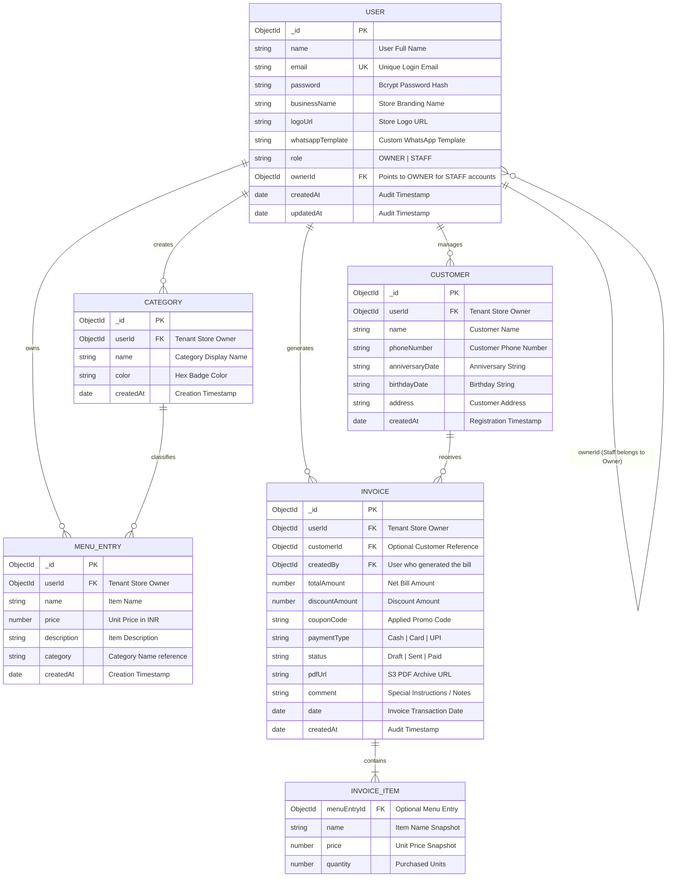

# Entity-Relationship Diagram (ERD) & Database Schema Specification

**Application:** WhatsApp Digital Invoicing & POS Application  
**Version:** 2.0.0 (Next.js 16.4.3 / React 19)  
**Database:** MongoDB via Mongoose ODM  
**Status:** Approved & Implemented  

---

## 1. Entity-Relationship Diagram

---

## 2. Performance Indexes Specification

To ensure sub-5 millisecond response times under multi-tenant workloads, the following compound and secondary indexes are maintained in MongoDB:

| Collection | Index Fields | Index Type | Purpose |
| :--- | :--- | :--- | :--- |
| **`invoices`** | `{ userId: 1, createdAt: -1 }` | Compound | Fast paginated transaction listing per store. |
| **`invoices`** | `{ userId: 1, customer: 1, date: -1 }` | Compound | Instant retrieval of customer invoices for the 90-day report. |
| **`customers`** | `{ userId: 1, name: 1 }` | Compound | Fast prefix name lookup and alphabetical sorting. |
| **`customers`** | `{ userId: 1, phoneNumber: 1 }` | Compound | Phone number search and duplicate prevention. |
| **`users`** | `{ email: 1 }` | Unique | O(1) login lookup and email uniqueness guarantee. |
| **`users`** | `{ ownerId: 1, role: 1 }` | Compound | Fast retrieval of staff members belonging to a store owner. |
| **`menuentries`**| `{ userId: 1, createdAt: -1 }` | Compound | Paginated menu catalog retrieval. |
| **`categories`** | `{ userId: 1, name: 1 }` | Compound | Auto-provisioning lookup during spreadsheet import. |
