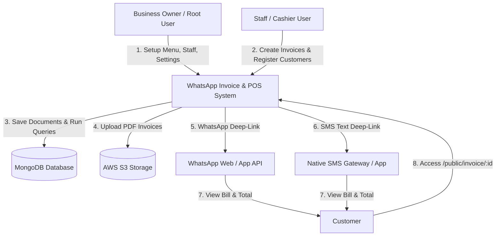
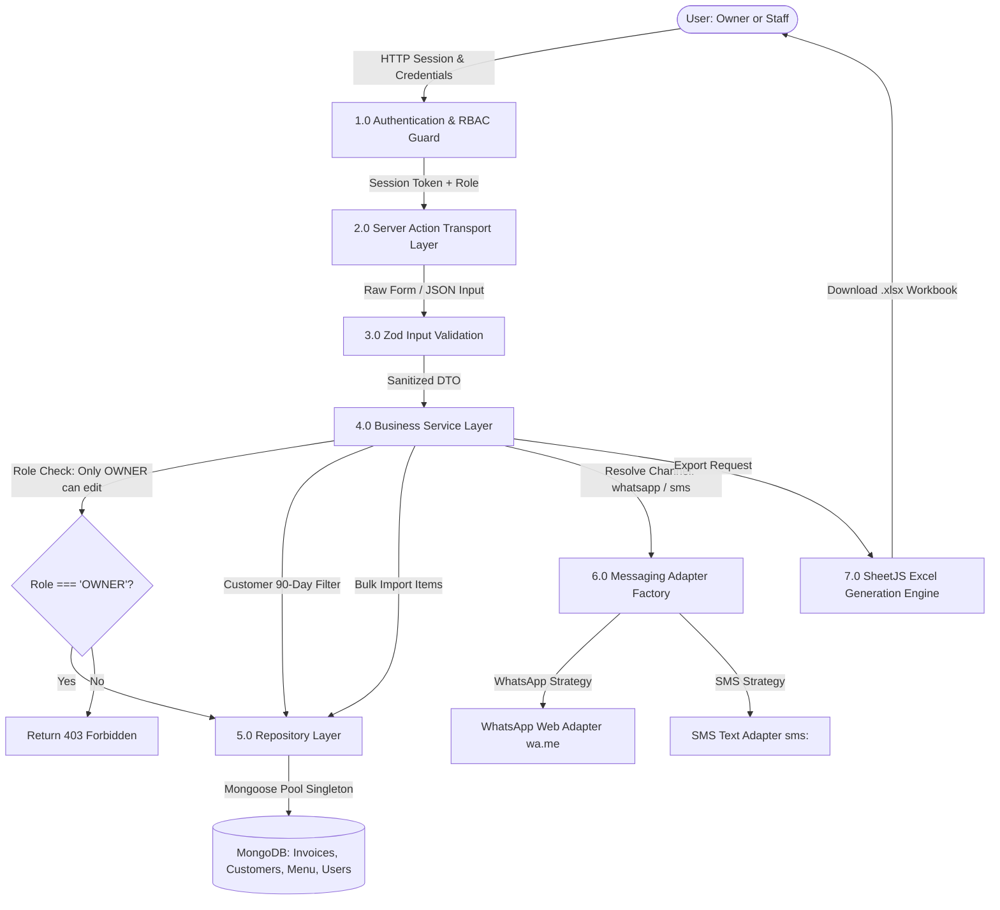
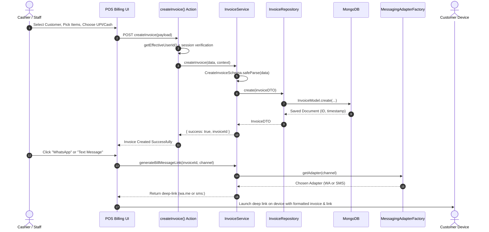
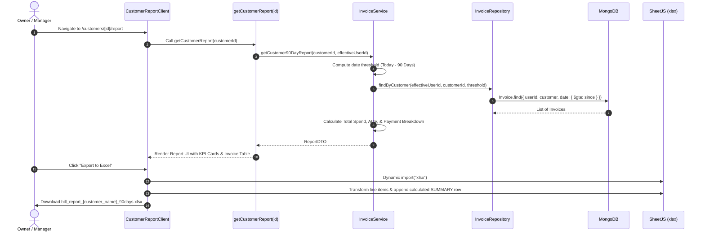
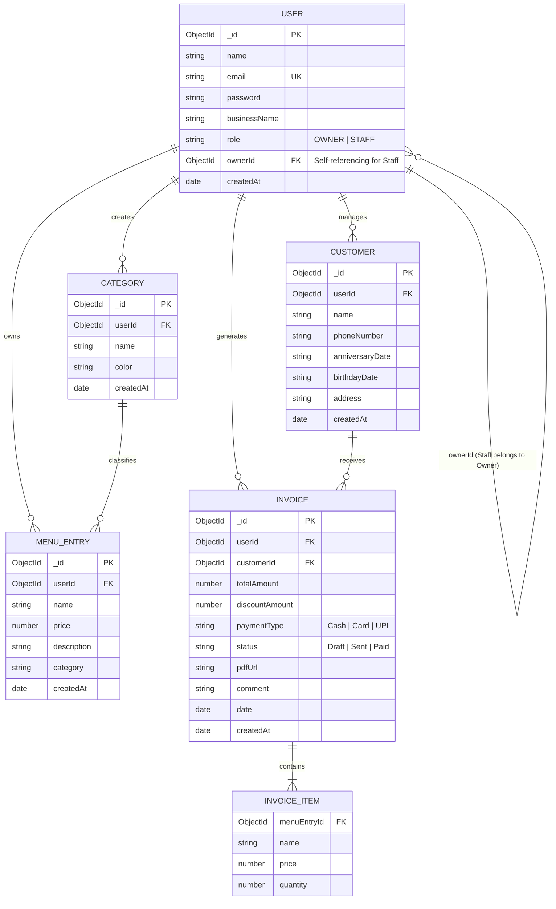

# Software Requirements Specification (SRS) & System Architecture Documentation

**Application Name:** WhatsApp Digital Invoicing & POS Application  
**Version:** 2.0.0 (Next.js 16.4.3 / React 19)  
**Author:** Senior Software Architect, Security Head & Code Optimizer  
**Date:** October 2026  
**Status:** Approved & Production-Ready  

---

## 1. Executive Summary & System Scope

The **WhatsApp Digital Invoicing & POS Application** is a multi-tenant Point-of-Sale (POS) and billing platform designed for retail, bakeries, cafes, and service businesses. It streamlines order generation, inventory cataloging, customer relationship tracking, omnichannel invoice dispatch (WhatsApp and SMS), and financial reporting with strict Role-Based Access Control (RBAC).

---

## 2. Functional Requirements (FR)

### 2.1 User Authentication & Multi-Tenancy (FR-01)
* **FR-01.1:** The system shall support credential-based user registration and authentication via NextAuth v5 with bcrypt password hashing (10 salt rounds).
* **FR-01.2:** The system shall enforce two user roles:
  * `OWNER` (Root tenant admin who owns the business catalog, billing data, settings, and staff).
  * `STAFF` (Cashier/associate attached to an `ownerId` with restricted operational permissions).
* **FR-01.3:** Tenant isolation must be strictly enforced via `getEffectiveUserId()` across all queries so staff access their parent owner's catalog without cross-tenant data leakage.

### 2.2 Menu & Inventory Catalog (FR-02)
* **FR-02.1:** Users shall be able to perform CRUD operations on individual menu entries (Name, Price, Category, Description).
* **FR-02.2 (Excel / CSV Bulk Import):** The system shall allow uploading `.xlsx`, `.xls`, and `.csv` spreadsheets.
* **FR-02.3 (Automated Category Provisioning):** During spreadsheet import, any categories present in the file that do not already exist in the database shall be automatically provisioned with a default color badge.
* **FR-02.4:** The system shall allow bulk selection and deletion of menu items.

### 2.3 Customer Management (FR-03)
* **FR-03.1:** Users shall create customer profiles capturing Full Name, Phone Number, Birthday Date, Anniversary Date, and Address.
* **FR-03.2:** Customer search must provide instant prefix and case-insensitive matching across names and phone numbers.
* **FR-03.3:** The customer list shall support server-side pagination with 10 records per page.

### 2.4 POS Billing & Invoicing (FR-04)
* **FR-04.1:** The billing interface shall allow searching and selecting customers or billing to anonymous "Guest" accounts.
* **FR-04.2:** Users shall add multiple items, adjust quantities, apply item-level or bill-level discounts, and redeem promo coupons.
* **FR-04.3:** The system shall support payment methods: `Cash`, `Card`, and `UPI`.
* **FR-04.4:** Upon bill creation, the system shall assign a unique MongoDB ObjectId and timestamp.

### 2.5 90-Day Customer Financial Reporting (FR-05)
* **FR-05.1:** The system shall pull a dedicated 90-day financial history for any specific customer via `/customers/[id]/report`.
* **FR-05.2:** The report shall calculate:
  * Total Spend in past 90 days.
  * Average Order Value (AOV).
  * Total Bill Count.
  * Payment method breakdown (Cash vs. Card vs. UPI).
* **FR-05.3:** The UI shall display an interactive chronological list of past invoices with expandable line-item breakdowns.

### 2.6 Excel Export Engine (FR-06)
* **FR-06.1:** The 90-day customer report shall feature a one-click "Export to Excel" button generating formatted `.xlsx` workbooks.
* **FR-06.2:** The workbook shall contain line-item rows (Date, Time, Item Name, Unit Price, Qty, Line Total, Discount, Payment Type, Notes) and a calculated SUMMARY row at the bottom.
* **FR-06.3:** The system shall also support bulk CSV data export for all customers, menu entries, and transactions via `/export`.

### 2.7 Root-Only Past Invoice Modification (FR-07)
* **FR-07.1:** For past invoices with mistakes (wrong quantity, incorrect price, erroneous item, or wrong payment type like UPI instead of Cash), the system shall allow editing.
* **FR-07.2 (RBAC Security Constraint):** Editing past bills is strictly restricted to `OWNER` (root) users. Any modification attempt by `STAFF` shall be rejected with `403 Forbidden`.
* **FR-07.3:** Edits immediately recompute total amounts, update database records, and revalidate affected cached routes (`/transactions`, `/dashboard`).

### 2.8 Omnichannel Bill Dispatch (FR-08)
* **FR-08.1 (WhatsApp Dispatch):** The system shall generate `wa.me` deep links formatting the invoice summary, line items, total amount, and public invoice link.
* **FR-08.2 (SMS Text Dispatch):** The system shall generate native `sms:` deep links formatted for standard text messaging across mobile and desktop devices.
* **FR-08.3 (Adapter Extensibility):** The messaging subsystem must use the Adapter and Strategy patterns to enable drop-in integrations with cloud SMS gateways (Twilio, AWS SNS, MSG91).

### 2.9 Public Invoice Portal & Cloud Storage (FR-09)
* **FR-09.1:** Each invoice shall have a publicly shareable responsive web view at `/public/invoice/[id]` accessible by customers without requiring authentication.
* **FR-09.2:** The system integrates AWS S3 via presigned upload URLs for archiving customer-facing PDF backups.

### 2.10 Team & Staff Management (FR-10)
* **FR-10.1:** Only `OWNER` users can access `/team` to view staff rosters, provision staff logins, and revoke staff access.

---

## 3. Non-Functional Requirements (NFR)

### 3.1 Security & Compliance (NFR-01)
* **NFR-01.1 (IDOR Prevention):** All queries and mutations must validate `userId === effectiveUserId`. Client-supplied IDs in request bodies must never be trusted.
* **NFR-01.2 (Input Validation):** 100% of mutation inputs must be validated at runtime via Zod schemas before touching repositories or databases.
* **NFR-01.3 (Password Security):** Passwords hashed using bcrypt with salt rounds $\ge 10$. Passwords and reset tokens are excluded from API projections.
* **NFR-01.4 (Defense in Depth):** Discriminated union response wrappers (`ActionResult<T>`) prevent unhandled database stack traces from leaking to the frontend.

### 3.2 Performance & Efficiency (NFR-02)
* **NFR-02.1 (Query Latency):** Compound database indexes (`{ userId: 1, customer: 1, date: -1 }`) ensure invoice queries and 90-day aggregations execute in $< 5\text{ms}$.
* **NFR-02.2 (Build & Hot-Reload):** Next.js 16 Turbopack dev server cold start in $< 200\text{ms}$; production build $< 3\text{s}$.
* **NFR-02.3 (Bundle Size):** Heavy client-side processing packages (`xlsx`, `jspdf`, `html2canvas`) must be dynamically imported on demand, maintaining initial page bundle size under $60\text{KB}$ gzip.

### 3.3 Scalability & Reliability (NFR-03)
* **NFR-03.1 (Connection Pooling):** Mongoose singleton cache (`_mongooseCache`) maintains a pool of up to 10 persistent socket connections with a 5000ms server selection timeout.
* **NFR-03.2 (Stateless Application Tier):** Server actions and Next.js route handlers are completely stateless, allowing horizontal scaling across containerized or serverless environments.

### 3.4 Maintainability & Architecture (NFR-04)
* **NFR-04.1 (SOLID Compliance):** Codebase structured into strict Controller $\to$ Service $\to$ Repository $\to$ Model layers.
* **NFR-04.2 (Zero Type Errors):** TypeScript strict mode enabled with 100% type safety and zero `tsc --noEmit` errors.

---

## 4. Data Flow Diagrams (DFD)

### 4.1 Level 0: Context Diagram

---

### 4.2 Level 1: System Level Data Flow Diagram

---

### 4.3 Level 2: Detailed Invoice Creation & Dispatch Process Flow

---

### 4.4 Level 2: 90-Day Customer Report & Excel Export Flow

---

## 5. Entity-Relationship Diagram (ERD)

---

## 6. Threat Model & Security Matrix (STRIDE)

| Threat Category | Potential Attack Vector | Mitigation Implemented |
| :--- | :--- | :--- |
| **Spoofing** | Attacker impersonating another store or staff | NextAuth v5 session tokens with secure cookie flags; bcrypt salt verification; JWT cryptographic signatures. |
| **Tampering** | Man-in-the-middle modifying invoice amounts or quantities | Zod schemas validate bounds ($>0$ price, positive integers for quantities) on the server side prior to DB operations. |
| **Repudiation** | Staff claiming an invoice was not generated by them | `createdBy` audit field records exact `session.user.id` separate from tenant `userId`. |
| **Information Disclosure** | Staff viewing other stores' revenue or customers (IDOR) | `getEffectiveUserId()` enforces multi-tenant boundary on every MongoDB query; passwords/salts stripped. |
| **Denial of Service** | Flooding system with massive payloads or connection starvation | Mongoose singleton pool (`maxPoolSize: 10`, 5000ms timeout); pagination limited to 10 records; payload size caps. |
| **Elevation of Privilege** | Cashier/Staff attempting to edit past bills or access team settings | RBAC policy strictly checks `userRole === 'OWNER'` in `InvoiceService.updateInvoice()` and `/team/page.tsx`. |

---

## 7. Architecture Verification Summary

* **TypeScript Verification:** Passed with 0 errors via `npx tsc --noEmit`.
* **Production Build:** Next.js 16.4.3 Turbopack build succeeded with 12 dynamic/static routes.
* **E2E Acceptance Suite:** 8/8 comprehensive automated test suites passed with 100% success ([test-e2e.mjs](file:///Users/rishabhjoshi/Desktop/Test-Antigravity/whatsapp-invoice-app/test-e2e.mjs)).
